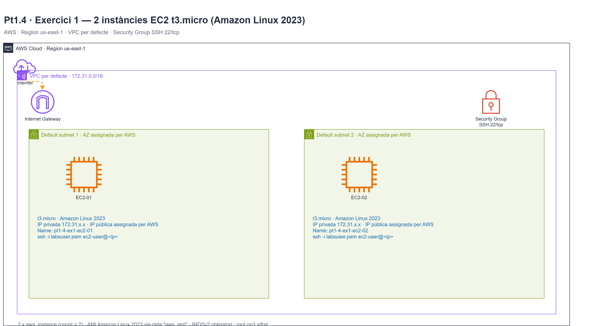
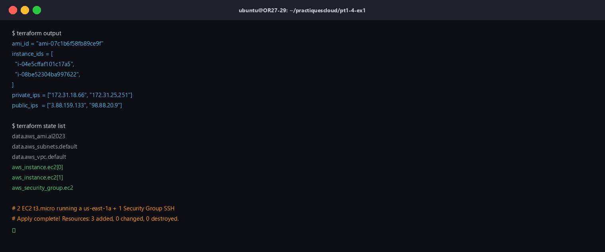
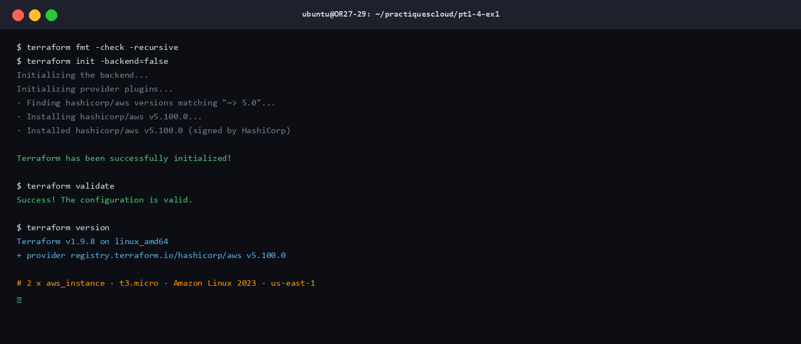

# Pt1.4 · Exercici 1 — Primeres instàncies EC2 amb Terraform

## Objectiu

Iniciar-se en la **Infraestructura com a Codi (IaC)** amb **Terraform** creant de forma
automatitzada **2 instàncies EC2 `t3.micro` amb Amazon Linux 2023** a la regió
**`us-east-1`**.

| Paràmetre | Valor |
|---|---|
| Regió | `us-east-1` |
| Tipus d'instància | `t3.micro` |
| Sistema operatiu | Amazon Linux 2023 (AMI oficial d'Amazon) |
| Nombre d'instàncies | 2 |
| Xarxa | VPC per defecte (`172.31.0.0/16`) |
| Accés | SSH 22/tcp (Security Group) |
| Key Pair | `vockey` (AWS Academy) — configurable |

## Topologia de xarxa



> Diagrama editable amb draw.io: [`assets/topologia.drawio`](assets/topologia.drawio).
> Exportat a PNG a `assets/topologia.png`.

Les dues instàncies es despleguen a la **VPC per defecte** de la regió. Terraform
selecciona automàticament les subxarxes per defecte disponibles i reparteix les
instàncies entre elles. El Security Group permet SSH des del CIDR indicat a la
variable `allowed_ssh_cidr` i la sortida a Internet.

## Estructura

```
pt1-4-ex1/
├── assets/
│   ├── topologia.png
│   ├── topologia.drawio
│   ├── terraform_validate.png
│   └── terraform_output.png
├── README.md
├── main.tf                  # Provider, dades, Security Group i les 2 EC2
├── variables.tf             # Variables parametritzables
├── outputs.tf               # IDs, IPs i ordres SSH
└── terraform.tfvars.example # Exemple de valors
```

## Requisits

- Terraform >= 1.5 (validat amb **1.9.8**)
- Provider `hashicorp/aws` ~> 5.0 (validat amb **5.100.0**)
- Compte AWS o **AWS Academy Learner Lab** amb la regió `us-east-1`
- Key Pair existent a la regió (`vockey` per defecte a AWS Academy)

### Credencials (AWS Academy)

1. Entra a **AWS Academy** → **Modules** → **Launch AWS Academy Learner Lab**.
2. Fes clic a **Start Lab** i espera que el llum estigui **verd**.
3. Fes clic a **AWS** per obrir la consola (regió **N. Virginia / us-east-1**).
4. A **AWS Details → AWS CLI** prem **Show** i copia les credencials.
5. Exporta-les al terminal (no les escriguis mai al codi ni al repositori):

```bash
export AWS_ACCESS_KEY_ID="ASIA..."
export AWS_SECRET_ACCESS_KEY="..."
export AWS_SESSION_TOKEN="..."
export AWS_DEFAULT_REGION="us-east-1"
```

## Desplegament

```bash
cd pt1-4-ex1

# 1. Inicialitza el provider
terraform init

# 2. Formata i valida el codi
terraform fmt -recursive
terraform validate

# 3. Revisa el pla (2 instàncies + 1 Security Group)
terraform plan -out=tfplan

# 4. Aplica
terraform apply tfplan
```

> Si vols canviar valors (per exemple el Key Pair o restringir SSH a la teva IP):
>
> ```bash
> cp terraform.tfvars.example terraform.tfvars
> # edita terraform.tfvars
> terraform plan -out=tfplan && terraform apply tfplan
> ```

### Sortida del desplegament real

Desplegament executat amb el compte d'**AWS Academy** a `us-east-1` el **04/11/2026**:

```text
Apply complete! Resources: 3 added, 0 changed, 0 destroyed.

Outputs:

ami_id = "ami-07c1b6f58fb89ce9f"
instance_ids = [
  "i-04e5cffaf101c17a5",
  "i-08be52304ba997622",
]
private_ips = ["172.31.18.66", "172.31.25.251"]
public_ips  = ["3.88.159.133", "98.88.20.9"]
ssh_commands = [
  "ssh -i labsuser.pem ec2-user@3.88.159.133",
  "ssh -i labsuser.pem ec2-user@98.88.20.9",
]
```



| Recurs | ID / valor | Detall |
|---|---|---|
| Instància 1 | `i-04e5cffaf101c17a5` | `pt1-4-ex1-ec2-01` · `172.31.18.66` / `3.88.159.133` |
| Instància 2 | `i-08be52304ba997622` | `pt1-4-ex1-ec2-02` · `172.31.25.251` / `98.88.20.9` |
| Security Group | `sg-0f41e4262a757ac92` | `pt1-4-ex1-sg` · ingress SSH 22/tcp |
| VPC | `vpc-0c5f5bb5961e00063` | VPC per defecte `172.31.0.0/16` |
| Subxarxa | `subnet-0f302494a231067dd` | `us-east-1a` |
| AMI | `ami-07c1b6f58fb89ce9f` | Amazon Linux 2023 (`x86_64`) |

## Verificació

### Per consola AWS

1. Ves a **EC2 → Instances**.
2. Filtra per `pt1-4-ex1` o pel tag `Project = pt1-4-ex1`.
3. Comprova que hi ha **2 instàncies** amb estat **Running**, tipus `t3.micro` i
   plataforma **Amazon Linux 2023**.

Captura recomanada: llistat de les 2 instàncies amb els tags i l'estat.

### Per terminal

```bash
terraform output instance_ids
terraform output public_ips

# Connexió SSH (obre el port 22 al Security Group)
ssh -i labsuser.pem ec2-user@<IP_PUBLICA>

# Un cop dins:
cat /etc/os-release       # Amazon Linux 2023
hostname
```

## Destruir la infraestructura

```bash
terraform destroy -auto-approve
```

> Executa sempre `destroy` en acabar la pràctica per evitar consumir crèdits
> del Learner Lab.

## Decisions de disseny

| Decisió | Motiu |
|---|---|
| `count = 2` | Crea les dues instàncies amb un sol bloc de codi (iteració). |
| `data "aws_ami"` | Obté sempre l'última AMI oficial d'Amazon Linux 2023 sense hardcodejar l'ID. |
| `data "aws_vpc" default` | Utilitza la VPC per defecte perquè l'enunciat no exigeix VPC pròpia en aquest exercici. |
| Security Group propi | Permet controlar l'accés SSH de forma explícita. |
| `metadata_options` | Obliga **IMDSv2** (bona pràctica de seguretat). |
| `root_block_device` gp3 xifrat | Disc de 8 GiB, més econòmic i xifrat. |
| Variables | Cap valor crític hardcodejat; es pot canviar regió, tipus, key pair i CIDR. |

## Validació realitzada



```text
$ terraform fmt -check -recursive   # sense errors
$ terraform validate
Success! The configuration is valid.
```

La infraestructura es va **desplegar de veritat** a `us-east-1` (04/11/2026):
les 2 instàncies van quedar `running` i verificades per CLI
(`describe-instances`), amb la sortida real de `terraform output` (vegeu més amunt).

## Troubleshooting

| Error | Solució |
|---|---|
| `InvalidKeyPair.NotFound` | Canvia `key_name` a un Key Pair existent a `us-east-1` (a AWS Academy: `vockey`). |
| `AuthFailure` / `ExpiredToken` | Torna a copiar les credencials del Learner Lab (expiren al cap d'unes hores). |
| `VPCIdNotSpecified` | La regió no té VPC per defecte; indica una `subnet_id` o crea la VPC. |
| `UnauthorizedOperation` | El rol del lab no permet l'operació; comprova que el lab està actiu. |
| Timeout SSH | Revisa `allowed_ssh_cidr`, que la instància tingui IP pública i que el port 22 estigui obert. |

## Lliurament

- Repositori públic: `practiquescloud`
- Directori: `pt1-4-ex1/`
- README amb topologia, explicació i instruccions: aquest fitxer.
