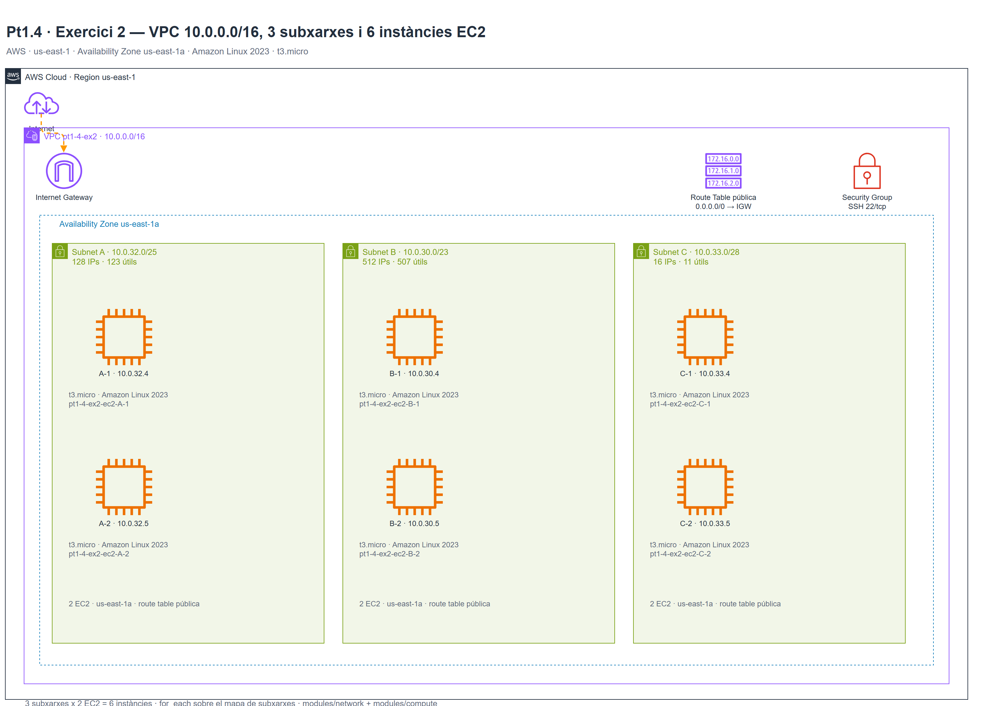
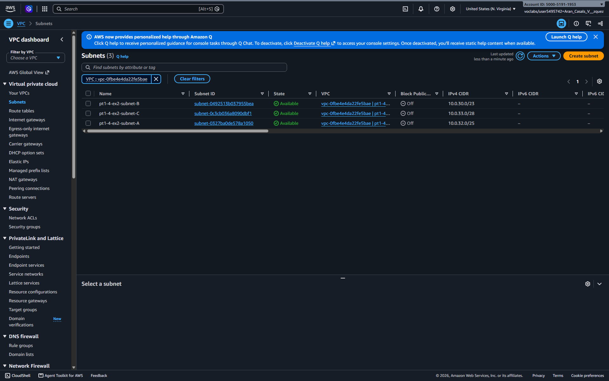
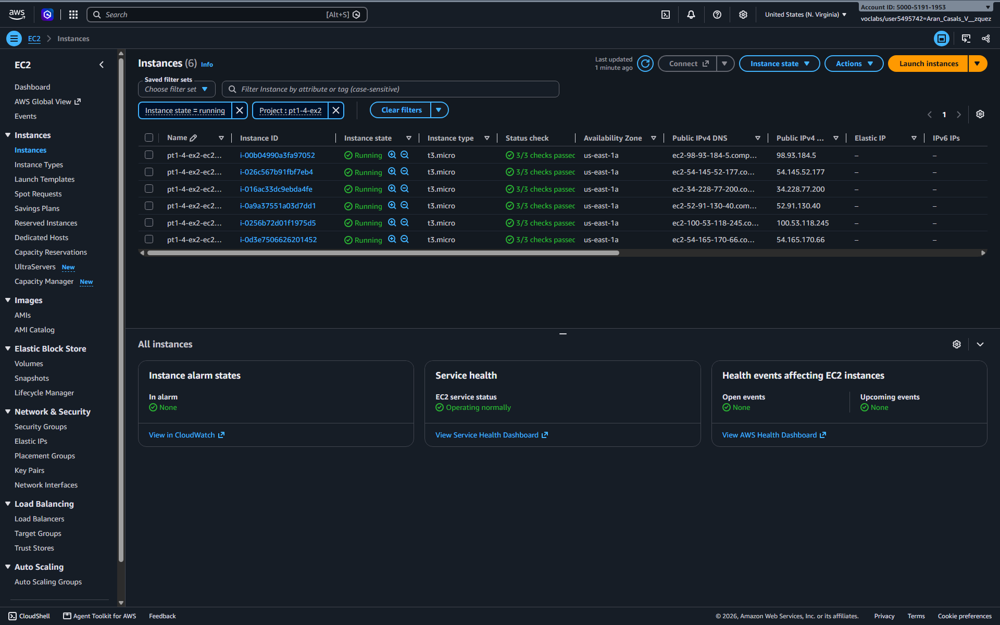
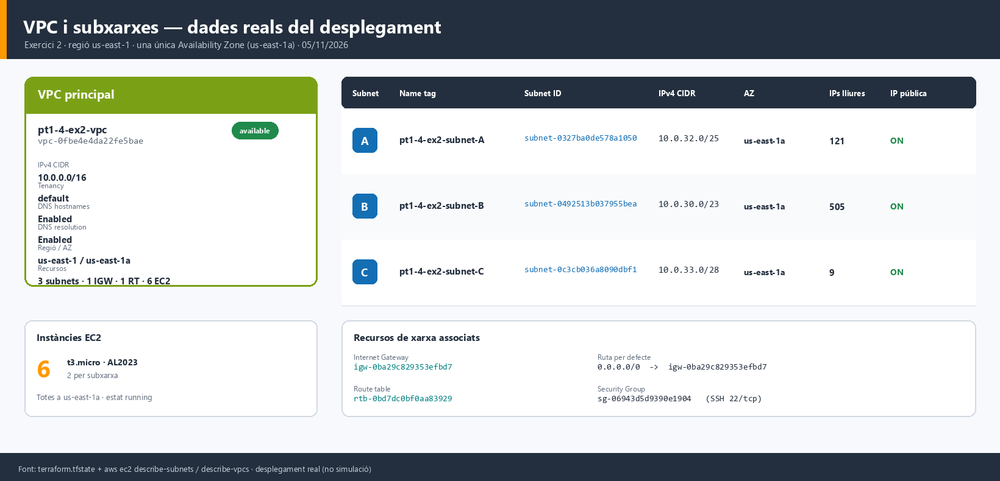
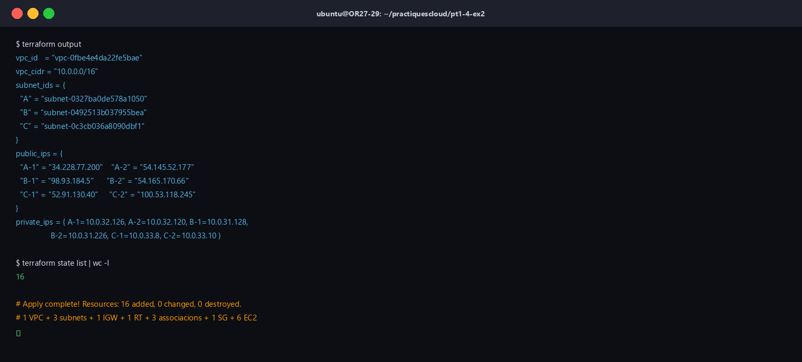
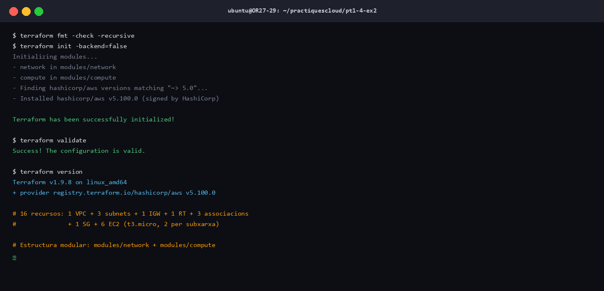

# Pt1.4 · Exercici 2 — VPC, 3 subxarxes i 6 instàncies EC2

## Objectiu

Dissenyar i desplegar una xarxa segmentada a AWS amb **una VPC, tres subxarxes a la
mateixa Availability Zone i sis instàncies EC2**, comparant el desplegament manual
per **consola** amb el desplegament automatitzat amb **Terraform (IaC)**.

| Paràmetre | Valor |
|---|---|
| Regió | `us-east-1` |
| Availability Zone | `us-east-1a` (les 3 subxarxes) |
| VPC | `10.0.0.0/16` |
| Subnet A | `10.0.32.0/25` |
| Subnet B | `10.0.30.0/23` |
| Subnet C | `10.0.33.0/28` |
| Instàncies | 2 per subxarxa = **6** · `t3.micro` · Amazon Linux 2023 |
| Accés | SSH 22/tcp |

---

## Part A — Disseny de xarxa

### Càlcul d'adreçament

| Subnet | CIDR | Màscara | Rang | Adreces | Útils* | EC2 |
|---|---|---|---|---|---|---|
| **A** | `10.0.32.0/25` | `255.255.255.128` | `10.0.32.0 – 10.0.32.127` | 128 | 123 | 2 |
| **B** | `10.0.30.0/23` | `255.255.254.0` | `10.0.30.0 – 10.0.31.255` | 512 | 507 | 2 |
| **C** | `10.0.33.0/28` | `255.255.255.240` | `10.0.33.0 – 10.0.33.15` | 16 | 11 | 2 |
| **VPC** | `10.0.0.0/16` | `255.255.0.0` | `10.0.0.0 – 10.0.255.255` | 65.536 | 65.531 | 6 |

\* AWS reserva **5 adreces per subxarxa** (adreça de xarxa, router de la VPC, DNS,
reservada per a futur ús i broadcast). Per això la primera IP assignable és la `.4`.

Comprovació que **no se solapen** i que totes caben dins la VPC:

- `10.0.32.0/25` → `10.0.32.0 – 10.0.32.127`
- `10.0.30.0/23` → `10.0.30.0 – 10.0.31.255`
- `10.0.33.0/28` → `10.0.33.0 – 10.0.33.15`
- Totes tres estan dins de `10.0.0.0/16` i no comparteixen cap adreça.

### Topologia



> Diagrama editable: [`assets/topologia.drawio`](assets/topologia.drawio).

### Resum de la VPC i les subxarxes



> **Captura real** de **VPC → Subnets** (05/11/2026) filtrada per la VPC del
> projecte (`vpc-0fbe4e4da22fe5bae`): es veuen les 3 subxarxes amb el nom, el
> Subnet ID, l'estat `Available`, el CIDR i la zona `us-east-1a`.

### Distribució de les 6 instàncies



> **Captura real** de **EC2 → Instances** (05/11/2026) amb el filtre
> `Project = pt1-4-ex2`: 6 instàncies `t3.micro` en estat `Running`, totes a
> `us-east-1a`, amb els IDs i les IPs públiques reals.

> La figura `vpc_resum.png` completa la informació amb el resum de la VPC,
> l'Internet Gateway, la route table i les IPs lliures de cada subxarxa,
> extretes del `terraform.tfstate` real.



---

## Part B — Desplegament per consola d'AWS (GUI)

> Totes les accions es fan amb la regió **N. Virginia (`us-east-1`)** seleccionada
> a la part superior dreta de la consola.

### B.1 Crear la VPC

1. **VPC → Your VPCs → Create VPC**.
2. **VPC only**.
3. Name tag: `pt1-4-ex2-vpc`.
4. IPv4 CIDR: `10.0.0.0/16`.
5. Tenancy: `Default`.
6. Create VPC.

### B.2 Crear les 3 subxarxes (mateixa AZ)

Per a cada fila de la taula, **VPC → Subnets → Create subnet**:

| Name tag | VPC | Availability Zone | IPv4 CIDR |
|---|---|---|---|
| `pt1-4-ex2-subnet-A` | `pt1-4-ex2-vpc` | `us-east-1a` | `10.0.32.0/25` |
| `pt1-4-ex2-subnet-B` | `pt1-4-ex2-vpc` | `us-east-1a` | `10.0.30.0/23` |
| `pt1-4-ex2-subnet-C` | `pt1-4-ex2-vpc` | `us-east-1a` | `10.0.33.0/28` |

Activa **Auto-assign public IPv4 address** a les tres subxarxes
(Subnets → selecciona → Actions → Edit subnet settings).

### B.3 Internet Gateway i taula de rutes

1. **VPC → Internet gateways → Create internet gateway**: `pt1-4-ex2-igw`.
2. Selecciona'l → **Actions → Attach to VPC** → `pt1-4-ex2-vpc`.
3. **VPC → Route tables → Create route table**: `pt1-4-ex2-rt-public`, VPC
   `pt1-4-ex2-vpc`.
4. **Routes → Edit routes → Add route**: `0.0.0.0/0` → `Internet Gateway` →
   `pt1-4-ex2-igw`.
5. **Subnet associations → Edit** → associa A, B i C.

### B.4 Security Group

1. **EC2 → Security Groups → Create security group**.
2. Name: `pt1-4-ex2-sg`, VPC: `pt1-4-ex2-vpc`.
3. **Inbound rules → Add rule**: `SSH` · `22` · `0.0.0.0/0`
   (o la teva IP, recomanat).
4. **Outbound rules**: tot el trànsit (`0.0.0.0/0`).
5. Create.

### B.5 Llançar les 6 instàncies

Per a cada subxarxa, **EC2 → Instances → Launch instances** (2 unitats):

| Nom | Subnet | Tipus | AMI | Key pair |
|---|---|---|---|---|
| `pt1-4-ex2-ec2-A-1` | `pt1-4-ex2-subnet-A` | `t3.micro` | Amazon Linux 2023 | `vockey` |
| `pt1-4-ex2-ec2-A-2` | `pt1-4-ex2-subnet-A` | `t3.micro` | Amazon Linux 2023 | `vockey` |
| `pt1-4-ex2-ec2-B-1` | `pt1-4-ex2-subnet-B` | `t3.micro` | Amazon Linux 2023 | `vockey` |
| `pt1-4-ex2-ec2-B-2` | `pt1-4-ex2-subnet-B` | `t3.micro` | Amazon Linux 2023 | `vockey` |
| `pt1-4-ex2-ec2-C-1` | `pt1-4-ex2-subnet-C` | `t3.micro` | Amazon Linux 2023 | `vockey` |
| `pt1-4-ex2-ec2-C-2` | `pt1-4-ex2-subnet-C` | `t3.micro` | Amazon Linux 2023 | `vockey` |

- **Network settings**: VPC `pt1-4-ex2-vpc`, subnet corresponent, Security Group
  `pt1-4-ex2-sg`, IP pública assignada.
- **Storage**: 8 GiB `gp3`.
- **Advanced details**: Metadata accessible `Enabled`, Metadata version `V2 only`.

### B.6 Captures de la part de consola

| Captura | On | Fitxer |
|---|---|---|
| Les 3 subxarxes del projecte | VPC → Subnets (filtre per VPC) | `assets/vpc_subnets.png` |
| Les 6 instàncies en execució | EC2 → Instances (estat `Running`) | `assets/ec2_instances.png` |

> `vpc_subnets.png` i `ec2_instances.png` són **captures reals** de la consola
> (05/11/2026). La primera filtra per la VPC `vpc-0fbe4e4da22fe5bae` i la segona
> pel tag `Project = pt1-4-ex2`. `vpc_resum.png` és el resum complementari
> (IGW, route table i IPs lliures) generat amb les mateixes dades reals de
> Terraform.

---

## Part C — Desplegament amb Terraform (IaC)

### Estructura modular

```
pt1-4-ex2/
├── assets/
│   ├── topologia.png
│   ├── topologia.drawio
│   ├── vpc_subnets.png
│   ├── vpc_resum.png
│   ├── ec2_instances.png
│   ├── terraform_validate.png
│   └── terraform_output.png
├── modules/
│   ├── network/            # VPC, 3 subnets, IGW, route table i associacions
│   │   ├── main.tf
│   │   ├── variables.tf
│   │   └── outputs.tf
│   └── compute/            # AMI, Security Group i les 6 EC2
│       ├── main.tf
│       ├── variables.tf
│       └── outputs.tf
├── main.tf                 # Crida els dos mòduls
├── variables.tf            # Variables i validacions
├── outputs.tf              # IDs, IPs i ordres SSH
├── terraform.tfvars.example
└── README.md
```

### Com funciona el bucle de les 6 instàncies

El mòdul `network` retorna un mapa `subnet_ids = { A = "subnet-...", B = ..., C = ... }`.
El mòdul `compute` el recorre amb un doble `for` i genera un mapa d'instàncies:

```hcl
locals {
  instances = merge([
    for subnet_key, subnet_id in var.subnet_ids : {
      for n in range(1, var.instances_per_subnet + 1) : "${subnet_key}-${n}" => {
        subnet_id   = subnet_id
        subnet_name = subnet_key
        number      = n
      }
    }
  ]...)
}

resource "aws_instance" "this" {
  for_each = local.instances
  # ...
}
```

Resultat: `A-1`, `A-2`, `B-1`, `B-2`, `C-1`, `C-2` → **6 instàncies** amb un sol
bloc de recurs. Canviar `instances_per_subnet` o afegir una subxarxa al mapa
escala el desplegament automàticament.

### Recursos que crea

| Recurs | Quantitat |
|---|---|
| `aws_vpc` | 1 |
| `aws_subnet` | 3 |
| `aws_internet_gateway` | 1 |
| `aws_route_table` | 1 |
| `aws_route_table_association` | 3 |
| `aws_security_group` | 1 |
| `aws_instance` | 6 |
| **Total** | **16** |

### Desplegament

```bash
cd pt1-4-ex2

terraform init
terraform fmt -recursive
terraform validate
terraform plan -out=tfplan
terraform apply tfplan
```

> Credencials d'AWS Academy al terminal:
>
> ```bash
> export AWS_ACCESS_KEY_ID="ASIA..."
> export AWS_SECRET_ACCESS_KEY="..."
> export AWS_SESSION_TOKEN="..."
> export AWS_DEFAULT_REGION="us-east-1"
> ```
>
> No posis mai les credencials dins del codi ni les pugis a GitHub.

### Sortides

```bash
terraform output
terraform output -json public_ips
terraform output -json instance_ids
```

Sortida real del desplegament (05/11/2026):

```text
vpc_id   = "vpc-0fbe4e4da22fe5bae"
vpc_cidr = "10.0.0.0/16"
subnet_ids = {
  "A" = "subnet-0327ba0de578a1050"
  "B" = "subnet-0492513b037955bea"
  "C" = "subnet-0c3cb036a8090dbf1"
}
private_ips = {
  "A-1" = "10.0.32.126"    "A-2" = "10.0.32.120"
  "B-1" = "10.0.31.128"    "B-2" = "10.0.31.226"
  "C-1" = "10.0.33.8"      "C-2" = "10.0.33.10"
}
public_ips = {
  "A-1" = "34.228.77.200"  "A-2" = "54.145.52.177"
  "B-1" = "98.93.184.5"    "B-2" = "54.165.170.66"
  "C-1" = "52.91.130.40"   "C-2" = "100.53.118.245"
}
```



#### Recursos creats (estat real)

| Recurs | ID | Detall |
|---|---|---|
| VPC | `vpc-0fbe4e4da22fe5bae` | `10.0.0.0/16` · DNS hostnames ON |
| Subnet A | `subnet-0327ba0de578a1050` | `10.0.32.0/25` · `us-east-1a` · 121 IPs lliures |
| Subnet B | `subnet-0492513b037955bea` | `10.0.30.0/23` · `us-east-1a` · 505 IPs lliures |
| Subnet C | `subnet-0c3cb036a8090dbf1` | `10.0.33.0/28` · `us-east-1a` · 9 IPs lliures |
| Internet Gateway | `igw-0ba29c829353efbd7` | `pt1-4-ex2-igw` |
| Route table | `rtb-0bd7dc0bf0aa83929` | `0.0.0.0/0 → IGW` · associada a A, B i C |
| Security Group | `sg-06943d5d9390e1904` | SSH 22/tcp |
| EC2 A-1 | `i-016ac33dc9ebda4fe` | `10.0.32.126` / `34.228.77.200` |
| EC2 A-2 | `i-026c567b91fbf7eb4` | `10.0.32.120` / `54.145.52.177` |
| EC2 B-1 | `i-00b04990a3fa97052` | `10.0.31.128` / `98.93.184.5` |
| EC2 B-2 | `i-0d3e7506626201452` | `10.0.31.226` / `54.165.170.66` |
| EC2 C-1 | `i-0a9a37551a03d7dd1` | `10.0.33.8` / `52.91.130.40` |
| EC2 C-2 | `i-0256b72d01f1975d5` | `10.0.33.10` / `100.53.118.245` |

`terraform state list` retorna **16 recursos** gestionats.

### Verificació

1. **VPC → Your VPCs**: `pt1-4-ex2-vpc` amb CIDR `10.0.0.0/16`.
2. **VPC → Subnets**: les 3 subxarxes amb els CIDR exactes i `us-east-1a`.
3. **EC2 → Instances**: 6 instàncies `t3.micro`, `Running`, 2 per subxarxa.
4. **Xarxa**: `terraform output -json private_ips` ha de mostrar IPs dins del
   rang CIDR de cada subxarxa (per exemple `10.0.32.126` a la subnet A i
   `10.0.33.10` a la C).

### Connexió SSH

```bash
# Exemple amb la primera IP pública
ssh -i labsuser.pem ec2-user@$(terraform output -json public_ips | python3 -c "import sys,json; print(json.load(sys.stdin)['A-1'])")
```

Un cop dins:

```bash
cat /etc/os-release     # Amazon Linux 2023
ip addr                 # IP privada dins la subxarxa
```

### Destruir

```bash
terraform destroy -auto-approve
```

---

## Decisions de disseny

| Decisió | Motiu |
|---|---|
| Mòduls `network` i `compute` | Separació de responsabilitats, codi reutilitzable i net. |
| `for_each` sobre mapes | Evita duplicar blocs i permet escalar subxarxes/instàncies. |
| `data "aws_ami"` | Agafa l'última AMI oficial d'Amazon Linux 2023. |
| Una sola AZ | Requisit explícit de l'enunciat (`us-east-1a`). |
| Subxarxes públiques | Requereixen `map_public_ip_on_launch` i ruta `0.0.0.0/0` a l'IGW. |
| Variables amb `validation` | Comprova que hi ha 3 subxarxes, CIDR vàlids i 2 EC2 per subxarxa. |
| `key_name` variable | Permet usar `vockey` (Academy) o un altre Key Pair sense tocar el codi. |
| IMDSv2 obligatori | Bona pràctica de seguretat. |

## Validació realitzada



```text
$ terraform fmt -check -recursive   # sense errors
$ terraform validate
Success! The configuration is valid.
```

A més, la infraestructura es va **desplegar de veritat** a `us-east-1`
(05/11/2026): `terraform apply` va crear els **16 recursos** i les 6 instàncies
van quedar `running`, verificades per consola i per CLI (`describe-instances`).

## Troubleshooting

| Error | Solució |
|---|---|
| `InvalidSubnet.Conflict` | Els CIDR se solapen o ja existeixen; revisa la taula de la Part A. |
| `InvalidKeyPair.NotFound` | Fes servir `vockey` o un Key Pair existent a `us-east-1`. |
| `AuthFailure` / `ExpiredToken` | Torna a copiar les credencials del Learner Lab. |
| `VpcLimitExceeded` | El compte ja té el màxim de VPC; elimina'n una o reutilitza-la. |
| Les instàncies no tenen IP pública | Activa `map_public_ip_on_launch` o reassocia la subxarxa. |
| No hi ha Internet | Comprova IGW adjunt, ruta `0.0.0.0/0` i associació de la route table. |

## Lliurament

- Repositori públic: `practiquescloud`
- Directori: `pt1-4-ex2/`
- Codi Terraform modular + README + diagrames + captures.
