# Pt2.2 — Infraestructura bàsica a AWS amb Terraform

Desplegament d'una xarxa bàsica a **AWS (`us-east-1`)** amb **Terraform**: una VPC amb
dues subxarxes públiques en dues zones de disponibilitat, Internet Gateway, taula de
rutes, grup de seguretat i dues instàncies EC2. Desplegament real fet el **18/11/2026**
amb un compte d'AWS Academy Learner Lab. Un cop capturades les evidències, els
recursos es van **destruir** amb `terraform destroy` el mateix dia.

| Paràmetre | Valor |
|---|---|
| Regió | `us-east-1` (N. Virginia) |
| VPC | `VPC-03` · `10.0.0.0/16` |
| Public Subnet A | `us-east-1a` · `10.0.1.0/24` · IP pública automàtica |
| Public Subnet B | `us-east-1b` · `10.0.2.0/24` · IP pública automàtica |
| Internet Gateway | `pt2-2-igw` · ruta `0.0.0.0/0` |
| Security Group | `pt2-2-sg` · SSH + ICMP de la VPC + egress total |
| Instàncies | `ec2-a` i `ec2-b` · `t3.micro` · Amazon Linux 2023 · clau `vockey` |
| Recursos creats | **10** (`terraform state list`) |

---

## Estructura de la carpeta

```
pt2-2/
├── assets/                         # captures reals (CLI + consola AWS)
│   ├── instalacion.png
│   ├── terraform_init.png
│   ├── terraform_validate.png
│   ├── terraform_plan.png
│   ├── terraform_apply.png
│   ├── terraform_output.png
│   ├── terraform_state.png
│   ├── vpc_resum.png
│   ├── vpc_subnets.png
│   ├── route_table_routes.png
│   ├── route_table_subnets.png
│   ├── security_group_inbound.png
│   ├── security_group_outbound.png
│   └── ec2_instances.png
├── README.md
├── main.tf                         # provider, xarxa, seguretat i instàncies
├── variables.tf                    # valors de l'enunciat amb validacions
├── outputs.tf                      # IDs, IPs i comandes SSH
├── terraform.tfvars.example
└── .terraform.lock.hcl
```

---

## Explicació dels exercicis (requisits de l'enunciat)

### 1. Proveïdor i regió

El bloc `provider "aws"` fixa `region = var.aws_region`, amb valor per defecte
`us-east-1`. El bloc `terraform` declara Terraform `>= 1.5` i el provider
`hashicorp/aws` `~> 5.0`. Les etiquetes per defecte (`Project`, `Environment`,
`ManagedBy`) s'apliquen a tots els recursos.

### 2. VPC i subxarxes públiques

`aws_vpc.this` crea **VPC-03** amb `10.0.0.0/16` i DNS habilitat. Dins seu,
`aws_subnet.public_a` (`10.0.1.0/24`, `us-east-1a`) i `aws_subnet.public_b`
(`10.0.2.0/24`, `us-east-1b`) tenen `map_public_ip_on_launch = true`, de manera que
qualsevol instància rep una IP pública automàticament en arrencar. Els CIDR i les AZ
estan validats a `variables.tf` per evitar desviacions de l'enunciat.

### 3. Internet Gateway i taula de rutes

`aws_internet_gateway.this` s'adjunta a la VPC. `aws_route_table.public` defineix la
ruta per defecte `0.0.0.0/0 → igw-...` i dues associacions
(`aws_route_table_association`) vinculen la taula a **totes dues** subxarxes. Sense
aquesta ruta les subxarxes serien públiques nominalment però sense accés a Internet.

### 4. Grup de seguretat

`aws_security_group.this` té exactament tres regles:

| Direcció | Protocol | Port | Origen / Destí |
|---|---|---|---|
| Ingress | TCP (SSH) | 22 | `0.0.0.0/0` (qualsevol lloc) |
| Ingress | ICMP (ping) | tots | `10.0.0.0/16` (només la VPC) |
| Egress | All (`-1`) | tots | `0.0.0.0/0` (tot el trànsit sortint) |

### 5. Instàncies EC2

Dues `aws_instance` (`t3.micro`) amb una AMI oficial d'**Amazon Linux 2023** obtinguda
amb `data "aws_ami"`. Cadascuna arrenca en una subxarxa diferent, fa servir el Key Pair
**`vockey`** i el security group creat, i s'etiqueta com a **`ec2-a`** i **`ec2-b`**.
`depends_on` garanteix que la ruta cap a Internet existeixi abans del llançament.

---

## Desplegament

Les credencials d'AWS Academy s'han de posar al terminal (**mai** al repositori):

```bash
export AWS_ACCESS_KEY_ID="ASIA..."
export AWS_SECRET_ACCESS_KEY="..."
export AWS_SESSION_TOKEN="..."
export AWS_DEFAULT_REGION="us-east-1"
```

```bash
cd pt2-2
terraform init
terraform fmt
terraform validate
terraform plan -out=tfplan
terraform apply tfplan
terraform output
terraform state list
```

### Eines instal·lades

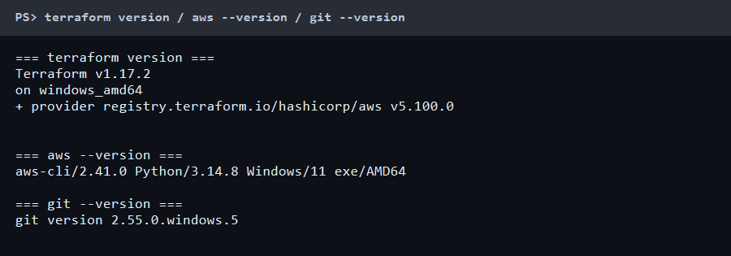

Terraform `1.17.2`, AWS CLI `2.41.0` i Git `2.55.0` instal·lats a l'equip abans de
començar. L'identitat verificada amb `aws sts get-caller-identity` és el rol
`voclabs` del compte `500051911953`, i el Key Pair `vockey` ja existeix a `us-east-1`.

### Validació del codi

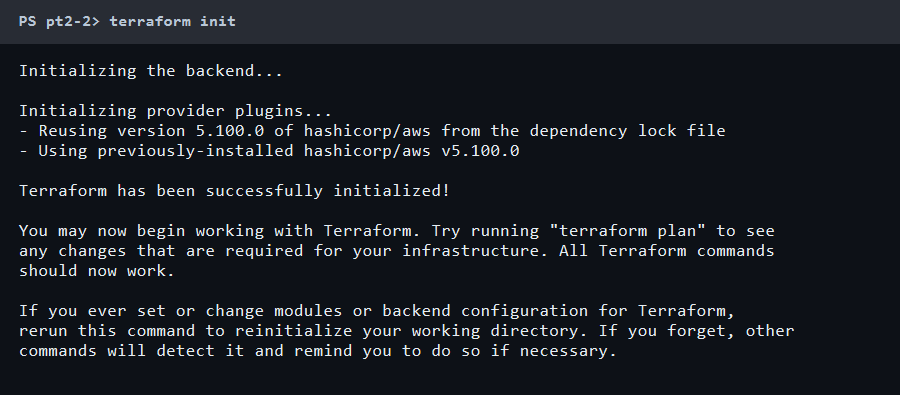

`terraform init` descarrega el provider `hashicorp/aws` i genera
`.terraform.lock.hcl` per fixar-ne la versió.

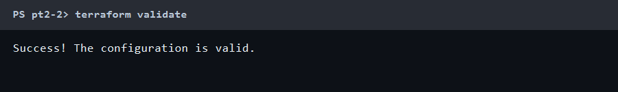

`terraform validate` confirma que la configuració és vàlida; `terraform fmt` no
retorna cap canvi.

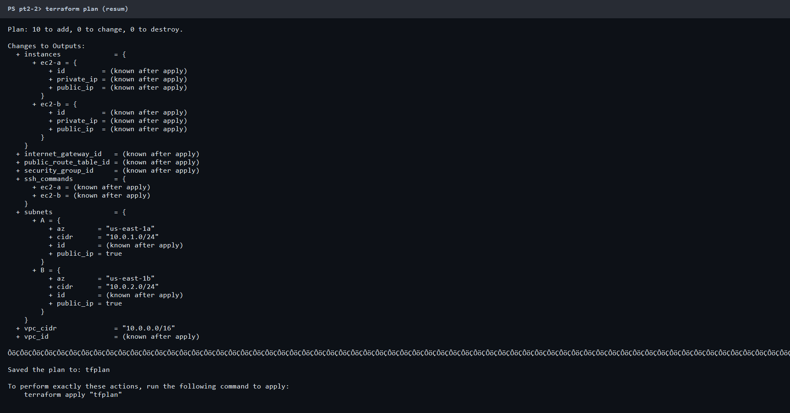

`terraform plan` mostra **10 recursos nous** i cap canvi ni eliminació.

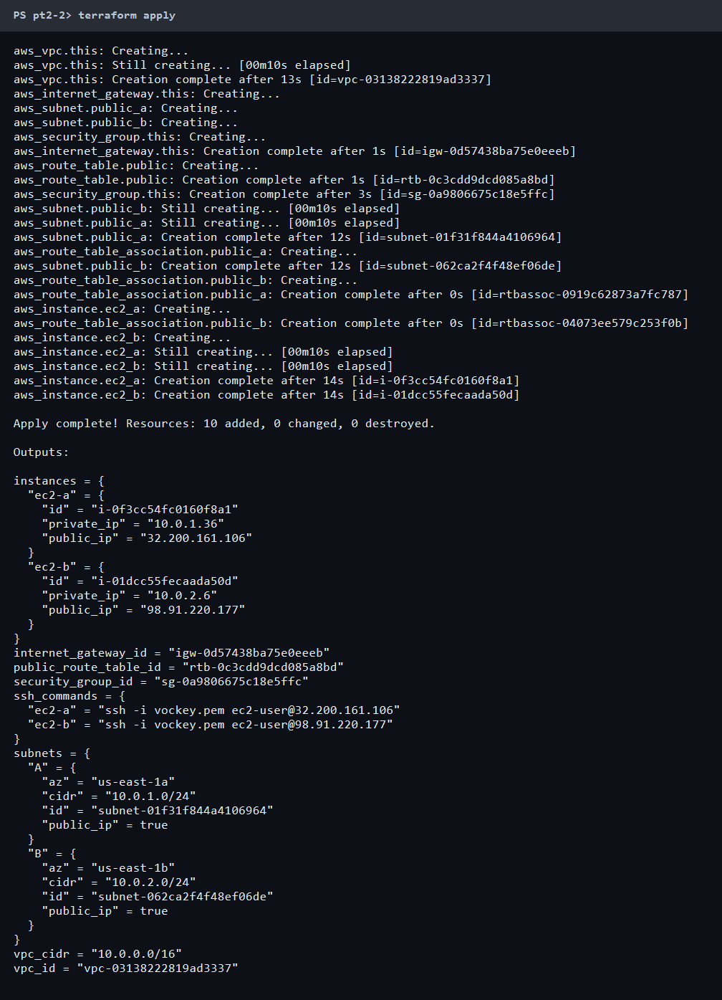

`terraform apply` crea els 10 recursos sense errors i mostra les sortides.

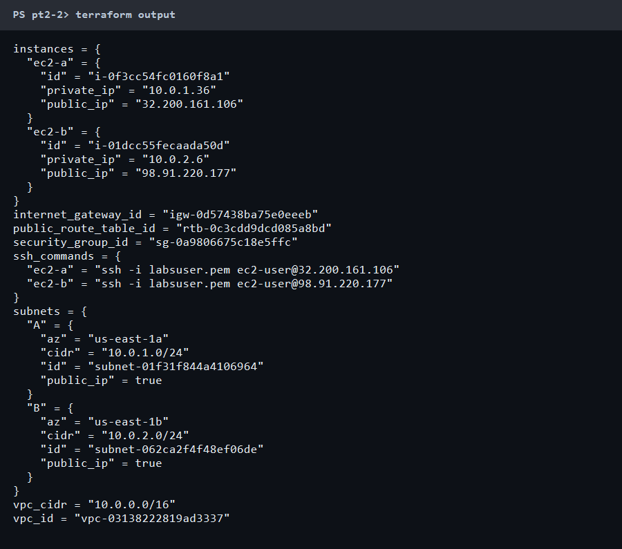

`terraform output` retorna els IDs reals, les IPs i les ordres SSH.

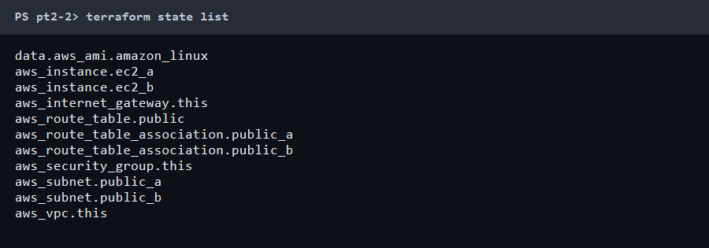

`terraform state list` confirma els 10 recursos gestionats.

---

## Verificació a la consola d'AWS

Totes les captures següents són de la consola real d'AWS a `us-east-1`, preses el
18/11/2026.

### VPC, subxarxes i Internet Gateway

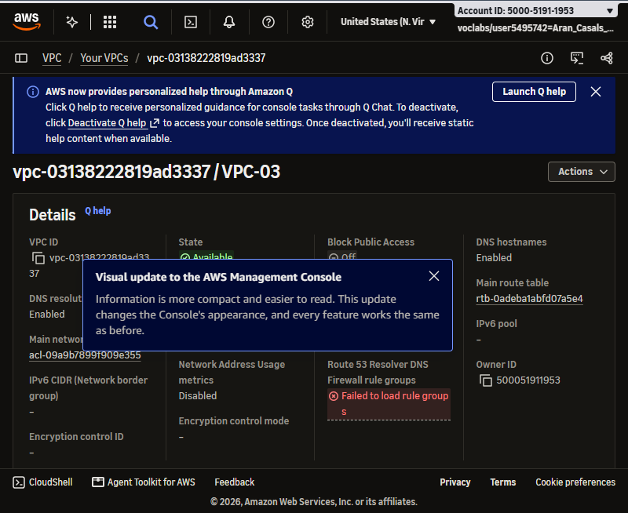

Detall de **VPC → Your VPCs → VPC-03**: CIDR `10.0.0.0/16`, DNS hostnames activat,
dues subxarxes (`Public Subnet A` a `us-east-1a` i `Public Subnet B` a `us-east-1b`),
dues taules de rutes i la connexió `pt2-2-igw`.

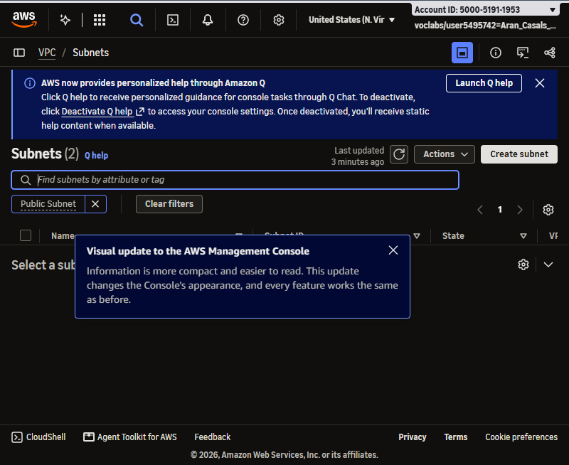

**VPC → Subnets** filtrat per `Public Subnet`: ambdues tenen IPv4 CIDR correcte,
estat `Available`, `Auto-assign public IPv4 address = Yes`, `Internet access = Yes
(public)` i la taula `pt2-2-public-rt` associada.

### Taula de rutes

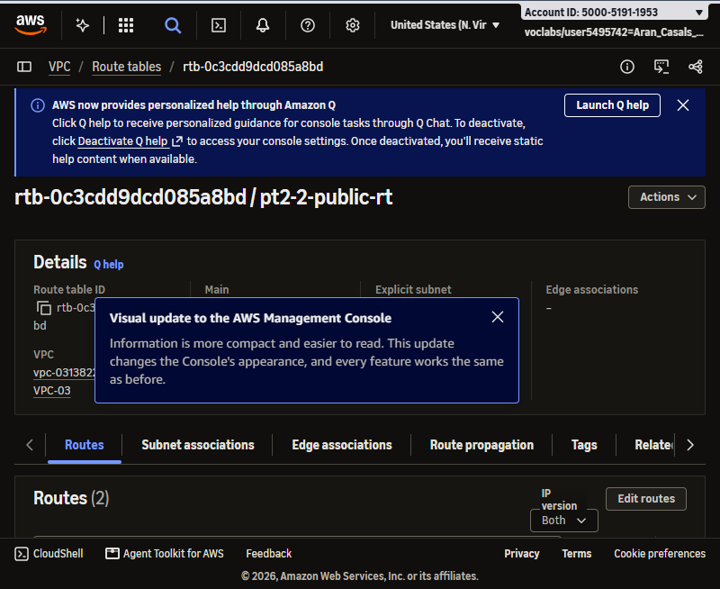

**Route tables → pt2-2-public-rt**: ruta `0.0.0.0/0` activa cap a
`igw-0d57438ba75e0eeeb`, a més de la ruta local `10.0.0.0/16 → local`.

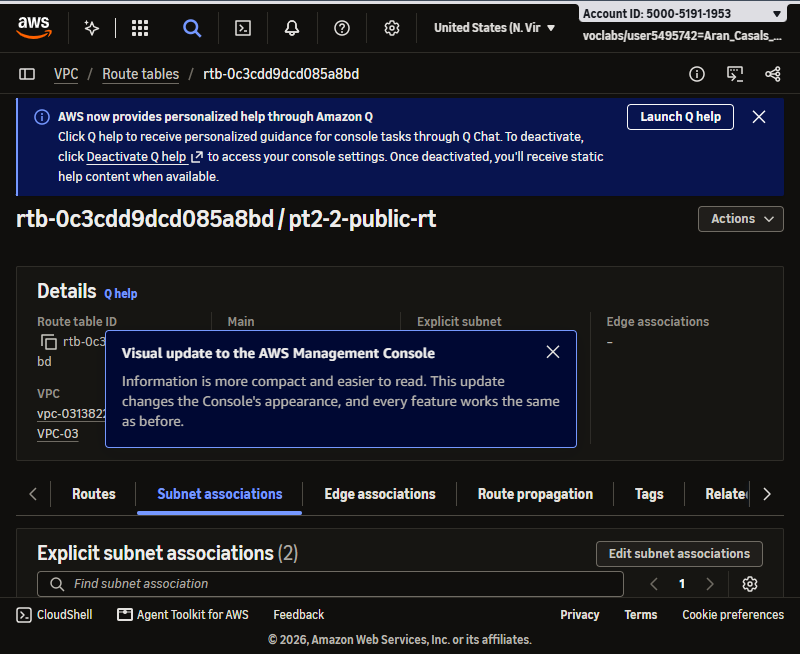

La pestanya **Subnet associations** mostra les dues subxarxes associades explícitament
i cap subxarxa sense associar.

### Security group

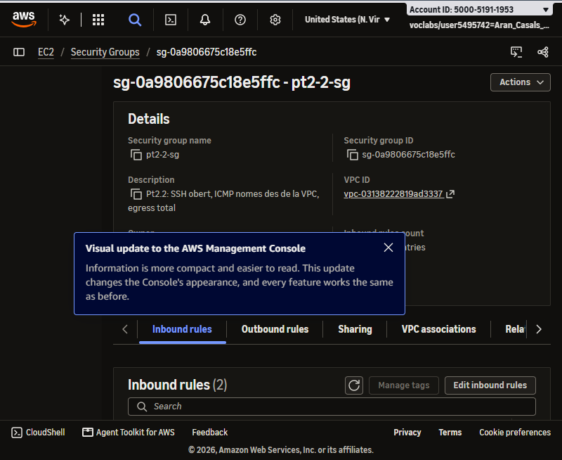

**EC2 → Security Groups → pt2-2-sg**, pestanya **Inbound rules**: SSH `22/tcp` des de
`0.0.0.0/0` i ICMP des de `10.0.0.0/16`.

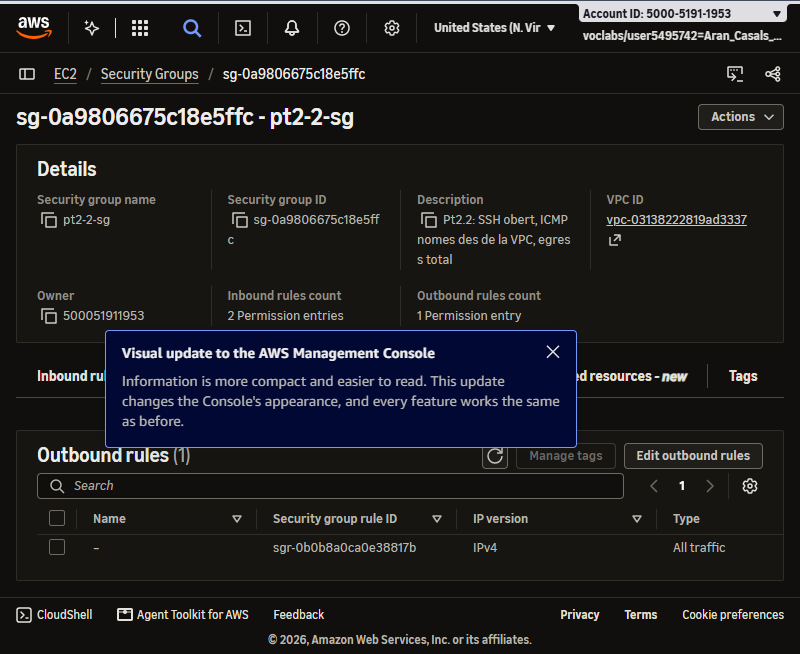

Pestanya **Outbound rules**: `All traffic / All / All` amb destí `0.0.0.0/0`.

### Instàncies EC2

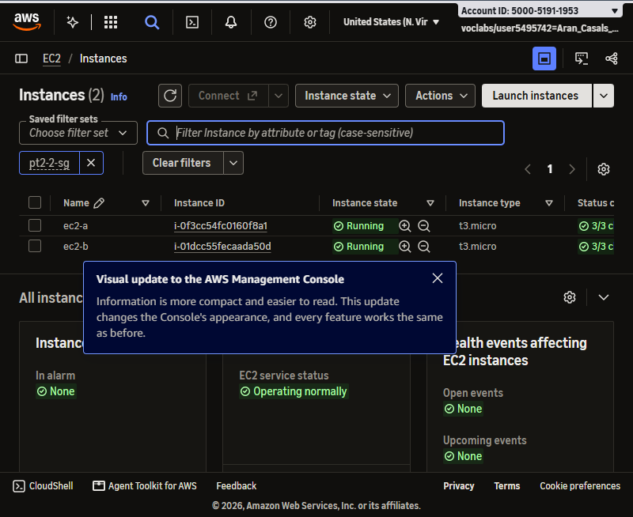

**EC2 → Instances** filtrat per `pt2-2-sg`: dues instàncies `t3.micro` en estat
`Running`, una a `us-east-1a` i l'altra a `us-east-1b`, amb IP pública, clau `vockey`
i security group `pt2-2-sg`.

---

## Resultat real del desplegament

| Recurs | ID | Detall |
|---|---|---|
| VPC | `vpc-03138222819ad3337` | `VPC-03` · `10.0.0.0/16` |
| Public Subnet A | `subnet-01f31f844a4106964` | `10.0.1.0/24` · `us-east-1a` |
| Public Subnet B | `subnet-062ca2f4f48ef06de` | `10.0.2.0/24` · `us-east-1b` |
| Internet Gateway | `igw-0d57438ba75e0eeeb` | adjunt a la VPC |
| Route table | `rtb-0c3cdd9dcd085a8bd` | `0.0.0.0/0 → IGW` · 2 associacions |
| Security Group | `sg-0a9806675c18e5ffc` | 2 ingress + 1 egress |
| ec2-a | `i-0f3cc54fc0160f8a1` | `10.0.1.36` / `32.200.161.106` · `us-east-1a` |
| ec2-b | `i-01dcc55fecaada50d` | `10.0.2.6` / `98.91.220.177` · `us-east-1b` |

---

## Connexió SSH i neteja

```bash
ssh -i labsuser.pem ec2-user@32.200.161.106   # ec2-a
ssh -i labsuser.pem ec2-user@98.91.220.177    # ec2-b

# Destrucció real feta el 18/11/2026 (10 recursos eliminats):
terraform destroy -auto-approve
```

La destrucció va eliminar la VPC, les dues subxarxes, l'Internet Gateway, la taula de
rutes i les seves associacions, el security group i les dues instàncies. Les captures
d'aquest README es van fer abans de la destrucció i en conserven la verificació.

Les credencials, `terraform.tfvars`, `tfplan` i `terraform.tfstate` **no es pugen** al
repositori (estan exclosos a `.gitignore`).
